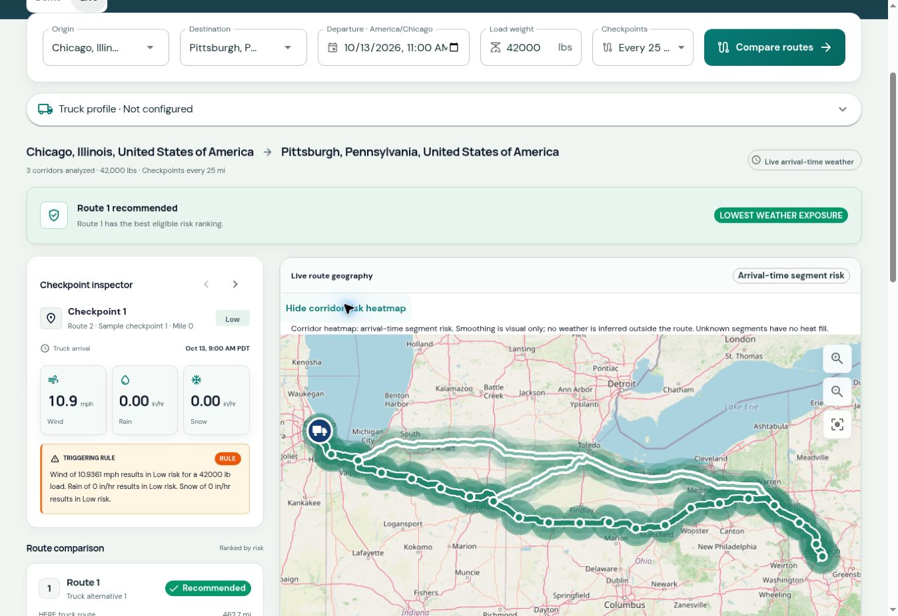
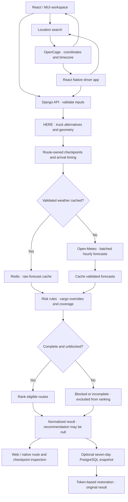

# Waycast · Weather-aware truck routing

Compare truck routes by the weather a driver is expected to encounter at each
checkpoint—not just by the fastest arrival. Built with **React, TypeScript,
Material UI, Django REST Framework, PostgreSQL and Redis**, with a separate
**React Native** driver app and a Docker-based deployment.

[**Open live workspace**](https://spotter.kiyoo.online/) ·
[**Download Android preview**](https://expo.dev/artifacts/eas/_w_78yy93G5WWHRZDOS4q6bTDjMzxBtpGOqYeuF-UGw.apk) ·
[Assessment evidence](docs/assessment-audit.md) · [Mobile setup](spotter-mobile/README.md) ·
[Loom Walkthrough](https://www.loom.com/share/bf6a1e73e95242948f2f6f16bacb854c)

The integration branch is **`develop`**. Demo mode needs no provider keys.
Live mode uses OpenCage locations, HERE truck routing and Open-Meteo forecasts.



*Real deployed browser journey, 13 October 2026. Route 2 is selected for inspection;
Route 1 remains the backend recommendation. Map bands show arrival-time risk.*

## Try it in five minutes

1. Open the workspace in **Demo** mode and select **Compare routes**.
2. Change the cargo load; inspect risk mileage and the triggering checkpoint rules.
3. Switch routes and checkpoints. Selection follows route ownership and does not
   change which route the API recommends.
4. Switch to **Live**, choose Chicago and Pittsburgh from location suggestions,
   and use an upcoming departure in the origin timezone. Compare the returned
   truck alternatives and inspect their arrival weather.
5. Enable the corridor risk heatmap; move the weather timeline through the longest
   journey. Forecast preview time is independent of arrival-time ranking.
6. Review **Why this route?**, compare departure windows, or open the driver
   briefing. A saved link restores the original result for seven days.

If coverage is incomplete, the app shows **Unknown** weather and an incomplete
route rather than inventing measurements or a recommendation.

## What is implemented

| Feature | Behavior |
| --- | --- |
| Demo / Live modes | Deterministic demo; real provider-backed locations, truck alternatives and forecasts in Live |
| Arrival-time weather | Route-owned checkpoints every 10/25/50 miles, plus origin and destination; wind, rain and snow evaluated at modeled arrival |
| Explainable ranking | Complete eligible routes rank by Severe miles, High miles, distance-weighted average risk, duration, then stable ID |
| Cargo and vehicle inputs | Cargo-based wind overrides; optional dimensions, actual/rated vehicle weights and heaviest axle weight for HERE |
| Geographic inspection | Provider geometry, checkpoint selection, risk colors and optional translucent corridor risk bands |
| Forecast exploration | Manual hourly preview through the longest alternative; estimated truck position, with no claim of live GPS |
| Departure comparison | Planned / +2h / +4h / +6h weather comparison on saved roads and timing |
| Saved analyses | Token-hashed server snapshots, seven-day share links, original-input restoration and printable briefing |
| Native Android app | Expo/React Native planning, maps, route/checkpoint inspection, reduced-motion welcome and saved-link restoration |
| Operational checks | Database/cache readiness, bounded provider calls, Redis weather cache, Docker deployment/backup checks and CodeQL |

Route labels **1/2/3** are readable presentation labels; provider IDs remain
internal to API ownership and selection. Eligibility rank is separate from route number.
Risk scoring is deterministic business logic, not a trained AI model.

## Architecture

| Layer | Responsibility |
| --- | --- |
| React / MUI web | TanStack Start Node SSR, responsive components, typed API clients and stale-request protection |
| Expo / React Native | Native driver UI using React Native Paper; calls the same Django API directly |
| Django / DRF | Validation, provider normalization, checkpoint sampling, risk classification, ranking and snapshots |
| PostgreSQL | Persistent saved-analysis snapshots; raw bearer tokens are not stored |
| Redis | Validated raw forecast caching; cargo-dependent risk is recomputed |
| Docker / Nginx | Frontend Node runtime and Gunicorn API under one origin, with database/cache services |

### Live analysis flow



Location selection is a separate request before submission. Cached weather remains
raw provider data; risk is recalculated for the submitted cargo. Selection and the
manual forecast preview do not modify the backend recommendation.
Provider failures return fixed public messages and request IDs; safe error categories
stay in server logs. Live failures never silently fall back to Demo.

## Run locally with Docker

Prerequisites: Git, Docker and Docker Compose. Local gateway uses port **80**;
if another service owns that port, adjust the local Compose port mapping.

```sh
git clone --branch develop https://github.com/Kiyoonewton/spotter.git
cd spotter
test -f spotter-backend/.env || cp spotter-backend/.env.example spotter-backend/.env
test -f spotter-infrastructure/.env || cp spotter-infrastructure/.env.example spotter-infrastructure/.env
cd spotter-infrastructure
docker compose -f docker-compose.local.yml up -d --build
curl -H 'Host: spotter.kiyoo' http://127.0.0.1/api/health
```

Expected health response: `{"status":"ok"}`. Open **http://localhost/** to use
Demo. The dev Nginx configuration declares `spotter.kiyoo`; optionally map that name
to `127.0.0.1` in your hosts file and open **http://spotter.kiyoo/**.

The checked-in credentials are local-only placeholders. Replace them for a real
server. Existing environment files are preserved by the commands above.
See [setup and troubleshooting](spotter-infrastructure/docs/getting-started.md).

### Live provider configuration

Set these in **`spotter-backend/.env`**, then recreate the backend service:

| Variable | Purpose |
| --- | --- |
| `OPENCAGE_API_KEY` | Live location search |
| `HERE_API_KEY` | Live truck routes |

Open-Meteo uses the public forecast endpoint. Keep provider keys server-side;
never place them in `VITE_*` variables or commit filled environment files.
See [provider setup, units and forecast semantics](docs/providers.md).

```sh
docker compose -f docker-compose.local.yml up -d --force-recreate spotter-backend
```

## React Native and Android

From the repository root:

```sh
cd spotter-mobile
npm ci
npx expo start
```

Use an SDK-compatible Expo client or native build. For a standalone signed APK:

```sh
npx eas-cli@latest login
npx eas-cli@latest build --platform android --profile preview
```

First-time owners must link their EAS project using `npx eas-cli@latest init`.
The preview APK runs without Metro or Expo Go; live planning still needs internet.
[Download the supplied Android preview](https://expo.dev/artifacts/eas/_w_78yy93G5WWHRZDOS4q6bTDjMzxBtpGOqYeuF-UGw.apk).
It is approximately **109 MiB** and includes four processor architectures.
Physical-device QA is not established by the automated bundle checks.
See the [release checklist](docs/android-release.md).

## Verification

Web uses the Node version in `spotter-frontend/apps/web/.nvmrc` and Yarn 1;
mobile CI uses Node 24 and npm. Backend containers use Python 3.12.

```sh
# Web (from spotter-frontend/apps/web)
yarn install --frozen-lockfile
test -f .env.test || printf 'VITE_API_BASE_URL=/api\n' > .env.test
yarn typecheck
yarn lint
yarn format:check
yarn test
yarn playwright install chromium
yarn test:e2e
yarn build

# Native (from spotter-mobile)
npm run typecheck
npm run lint
npm test
npm run export:native

# Full backend checks, with the local stack running (from spotter-infrastructure)
docker compose -f docker-compose.local.yml exec spotter-backend python manage.py check
docker compose -f docker-compose.local.yml exec spotter-backend python manage.py test

# Repository policy (from the repository root)
bash scripts/check-file-lengths.sh
```

Set `VITE_API_BASE_URL=/api` in the web `.env` for standalone web development/builds;
Playwright starts its Vite server. The web suites include mocked browser journeys;
[infrastructure E2E](spotter-infrastructure/tests/e2e) separately tests the real
frontend/API through Nginx. Do not overwrite an existing `.env.test` with credentials.

[GitHub Actions](https://github.com/Kiyoonewton/spotter/actions) checks backend/web/native
behavior, browser journeys, Docker, deployment contracts, CodeQL and file length.
Fixture tests, JS exports, signed APKs and real-device/provider verification are
separate evidence. See the dated [verification record](docs/assessment-audit.md).

## Limits and trade-offs

- Missing or out-of-horizon weather stays Unknown; incomplete and blocked routes
  cannot win recommendation. No fabricated forecast or extra route fallback.
- HERE span timing uses an explicit distance-proportional fallback when needed.
  Driver breaks, hours-of-service rules and ELD logs are not modeled.
- Corridor bands show sampled segment risk, not radar or weather away from the
  road. The estimated truck marker is not GPS or turn-by-turn navigation.
- Departure comparison refreshes weather on saved geometry/timing; it does not
  recalculate time-dependent traffic routes.
- Snapshots preserve original analysis weather; they are not refreshed forecasts.
  Anyone with a share link can view its trip. Phone results are memory-only;
  an on-device history/offline planner is not implemented.
- Provider access, forecast coverage and OSM tiles can fail. Mobile gesture,
  installation and accessibility QA must still be performed on a device.

## Repository and further reading

| Directory | Contents |
| --- | --- |
| `spotter-frontend/apps/web` | Web workspace, API clients, components and browser/unit tests |
| `spotter-backend` | Provider adapters, algorithms, APIs, models and backend tests |
| `spotter-mobile` | Native screens, planning, maps, bundled assets and native tests |
| `spotter-infrastructure` | Compose, Nginx, deployment/backup scripts and full-stack E2E |
| `docs` | Provider/timing policies, product limitations and release evidence |

[Assessment/architecture](spotter-frontend/apps/web/ASSESSMENT.md) ·
[Checkpoint timing](docs/route-timing.md) · [Truck profile](docs/truck-profile.md) ·
[Forecast caching](docs/corridor-forecast.md) · [Saved analyses](docs/saved-analyses.md) ·
[Departure comparison](docs/departure-comparison.md) · [Contribution rules](AGENTS.md)
